# TMOP — Task Manager OverPowered

[](https://github.com/tekikaito/tmop/actions/workflows/ci.yml)
[](https://github.com/tekikaito/tmop/releases/latest)
[](https://github.com/tekikaito/tmop/releases)
[](LICENSE)


**TMOP is a free task manager and system monitor for Windows, Linux and macOS.** Processes with a tree view, per-core CPU, graphics card, disks, a Docker page and skins, and no telemetry.

TMOP shows what your computer is doing: how busy the processor, memory, disk, network and
graphics card are, which programs are running, and much more. It is free and open source, and
needs no installer.

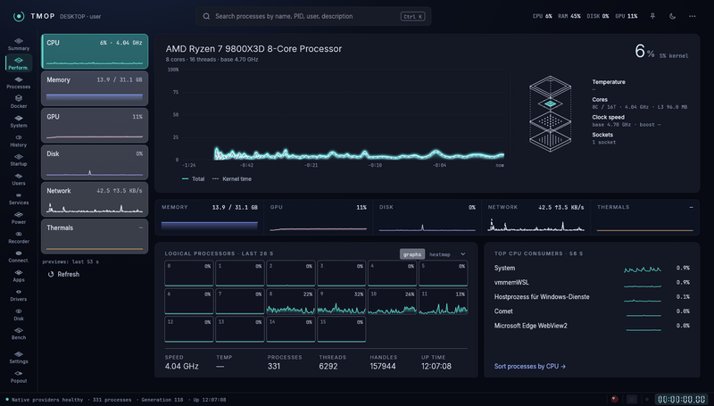

| Windows | Linux | macOS |
|---|---|---|
| 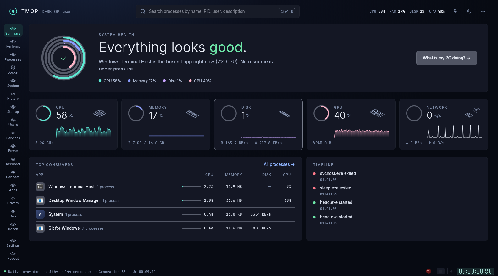 | 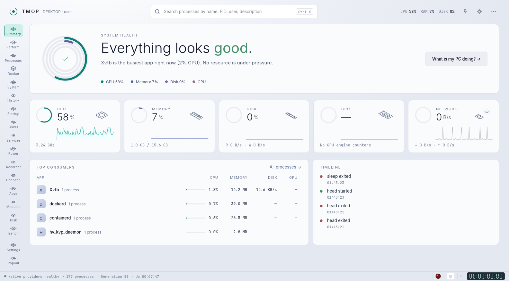 | 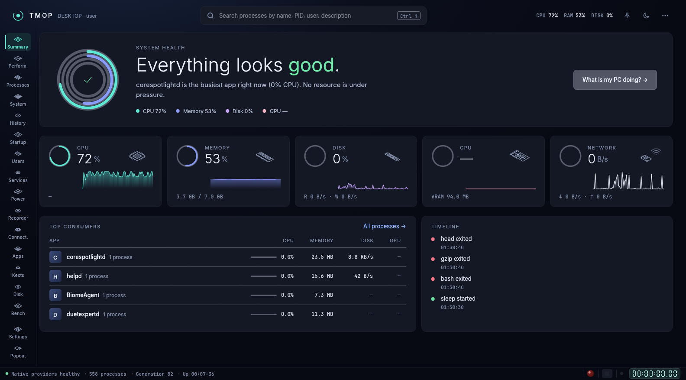 |

**[Download TMOP](https://tekikaito.github.io/tmop/)** · [All install options](#get-tmop) ·
[Release notes](https://github.com/tekikaito/tmop/releases)

Install with one command (run it again to update):

```powershell
# Windows, in PowerShell
irm https://tekikaito.github.io/tmop/install.ps1 | iex
```

```sh
# Linux and macOS, in a terminal
curl -fsSL https://tekikaito.github.io/tmop/install.sh | sh
```

## Why TMOP

- **Free and open source.** Every feature is free, with no paid tier. GPL-3.0.
- **One app on Windows, Linux and macOS.** A few things exist on one system only, or differ
  between them (see [Platforms](#platforms)). Where a system can't provide something, TMOP hides
  it instead of showing zeros.
- **More than processes and graphs.** Per-core CPU, memory, disk (each disk on its own if you
  like), network and graphics card, with engines where the system reports them and its temperature (Windows and Linux; Intel, AMD and NVIDIA graphics on Linux); processes with
  end task, suspend and priority; services you can start and stop, startup apps you can turn on and off, installed apps, connections; table
  columns you can put in any order; a Disk Space scan with a treemap; benchmarks; a flight recorder; and a Docker page.
- **Skinnable.** Skins, palettes and fonts change how it looks. Skins use the `.tmogskin`
  format, and TMOP can take the place of Windows Task Manager (Ctrl+Shift+Esc, Windows only).
- **No installer, no telemetry.** TMOP is one program, and it sends no data (see
  [Privacy](#privacy)).


## What you can do with it

| See your computer's performance live | Find and close programs |
|---|---|
| 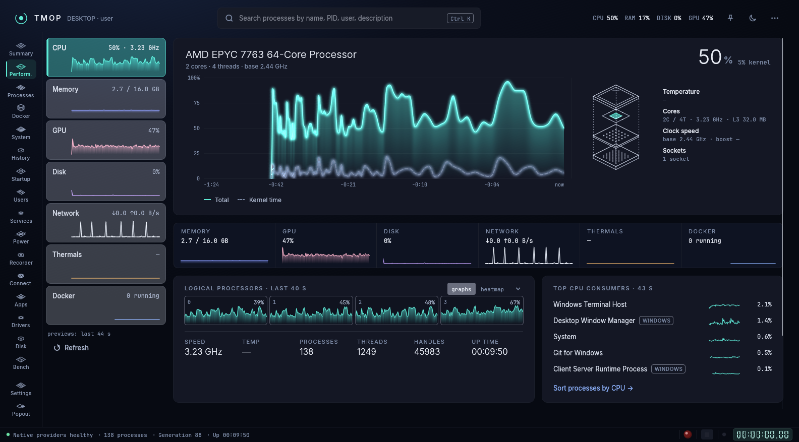 | 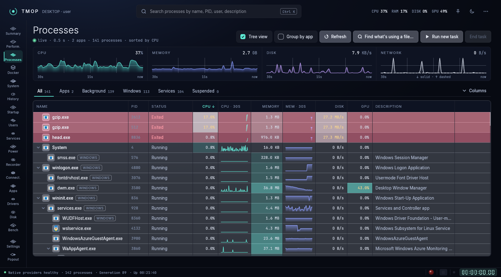 |
| **Test how fast your computer is** | **Keep a small monitor on your desktop** |
| 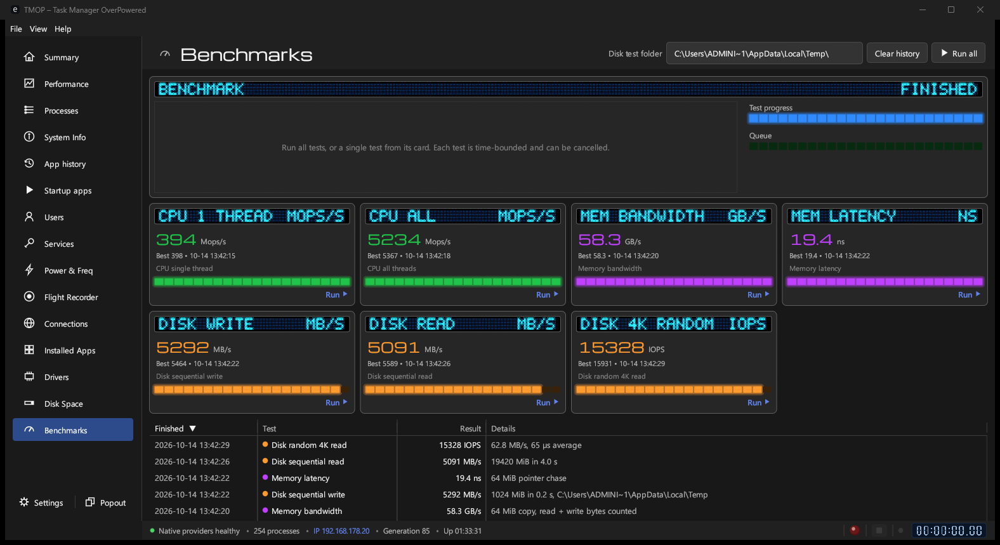 | 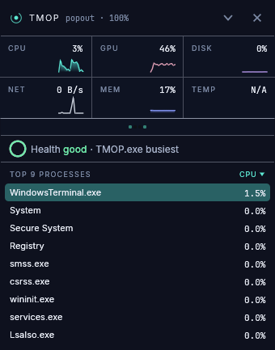 |
| **See what starts with your computer** | **Get an alert when something runs hot** |
| 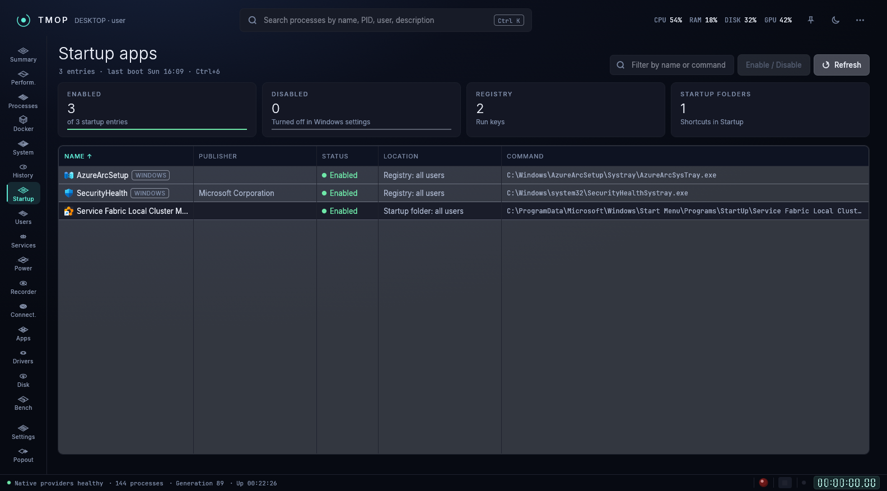 | 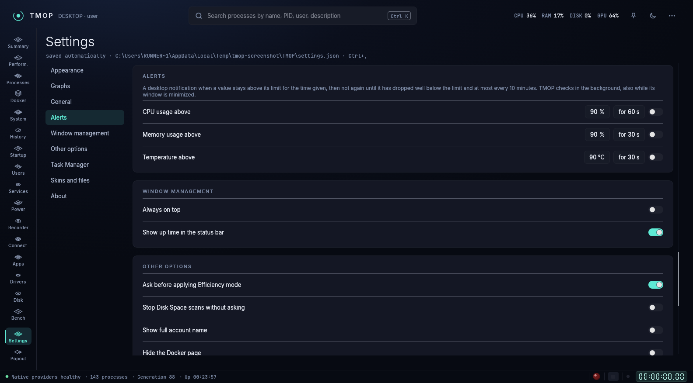 |
| **Start, stop or restart a service** | |
| 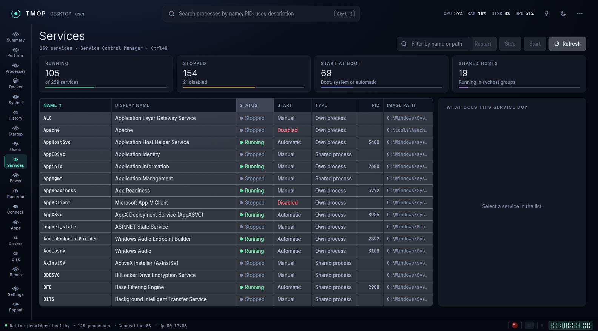 | |

- **Close a program that hangs:** go to *Processes*, right-click it and choose *End task*.
- **See which program started which:** on *Processes*, tick *Tree view*. Each process sits under the one that started it; click the arrow, or press Left and Right, to fold a branch in or out. A process whose parent has exited (or whose parent's number now belongs to a newer process) starts a branch of its own. Sorting works among the processes of one branch, and the search box and the tabs above the list keep the processes that match together with the ones above them (shown faint, with every branch open). A folded process shows its own figures, not those of its branch. *Group by app* and *Tree view* are separate views: ticking one turns the other off. *Group by app* folds each process into the entry of the program that started it, and a process with a window always has an entry of its own; on Linux and macOS each process started by the init system (systemd, launchd) or by a service manager (the systemd user manager, runit, s6) is an entry of its own too, one per service or program, and the kernel threads share one entry. TMOP remembers the view; folded branches are forgotten when it closes.
- **Catch programs that start and stop quickly:** on *Processes*, a program that just started shows in green for a moment, and one that just exited stays in its place in red, with its last figures, before it goes. An exited program cannot be ended or changed any more, so its menu has no actions, it no longer counts in a group's totals, and it is not in a CSV export. Turn this off or choose 1, 2 or 5 seconds under *Settings → General*.
- **Choose which processors a program may use:** on *Processes*, right-click it and choose *Set affinity…* (Windows and Linux; on a Windows PC with several processor groups, meaning more than 64 logical processors, it is hidden). Tick the logical processors it may run on; at least one stays ticked.
- **Send a specific signal (Linux and macOS):** on *Processes*, right-click a program and open *Send signal* to send exactly one of SIGTERM, SIGKILL, SIGINT, SIGHUP, SIGQUIT, SIGUSR1, SIGUSR2, SIGSTOP or SIGCONT. Unlike *End task*, nothing else follows it (no SIGCONT first, no SIGKILL later). Signals that end a program by default ask first. If the system refuses, Linux offers to retry as administrator (pkexec).
- **Look up, inspect or dump a program:** on *Processes*, right-click it. *Search online* opens a web search for its name (only the name is sent). *Go to services* shows the services it hosts on the *Services* page (only for a process that hosts one). On Windows, *Properties* opens the file's Properties dialog, and *Create dump file* writes a full memory dump to your temp folder (it holds everything the program had in memory, so keep it private).
- **Start a program:** on *Processes*, press *Run new task*, type a program (on Windows also a document, folder or web address) or pick one with *Browse…*, and press Enter. On Windows, *Run as administrator* starts it with full rights; on Linux and macOS the line is split like a shell would, without running one.
- **Start, stop or restart a service:** on *Services*, select it and press *Start*, *Stop* or *Restart* above the list, or right-click it. Only what the service's state allows is offered: a service that does not accept Stop, or (macOS) a KeepAlive job that launchd would start again at once, is greyed out with the reason. Stop and Restart ask first and name the running services that stop with it (Windows). TMOP then reads the service again and shows what the system says, or the system's error. It never asks for more rights: without administrator (Windows) or root (Linux system units, macOS daemons) the buttons are greyed out.
- **Find what is using a file:** if a file cannot be moved or deleted because it is open, choose *Find what's using a file…* in the *More* menu (the dots) or on *Processes*, then type, browse to or drop the file. TMOP lists the programs that have it open, each with *Show in Processes* and *End task*. Only files are checked; on Linux and macOS without administrator rights only your own processes are.
- **Find out what fills your disk:** go to *Disk Space* and start a scan.
- **Check your laptop battery's health:** *Power & Freq* shows a *Battery health* tile with the full charge against the design capacity (in percent and Wh) and the cycle count, where the system reports them.
- **See which programs start with your computer, which apps are installed** and a lot more in the
  menu on the left.
- **Open the small desktop monitor** with the *Popout* button at the bottom left.
- **See each disk on its own:** right-click the *Disk* card on *Performance* or *Summary* and
  choose *Show disks separately* (it only appears when TMOP finds two or more disks).
- **Put table columns in the order you like:** drag a column header onto another column, or
  right-click it for *Move left* and *Move right*.
- **Take a table with you:** right-click a column header and choose *Copy table as CSV* or *Save
  table as CSV…*. You get the visible columns in their current order and the rows as filtered and
  sorted, ready for a spreadsheet or a bug report.
- **Get told when something runs hot:** in *Settings → Alerts* TMOP sends a desktop notification when CPU usage, memory usage or the temperature stays above a limit you set for a while, naming the busiest process. All three are off by default, they also work while the window is minimized, and the temperature alert appears only where TMOP can read a temperature. It watches the hottest reading of the CPU, the board sensors and the graphics card's own temperature, and the notification names it ("Hottest: GPU 92°C (WDDM)"). A graphics card's hot spot and memory temperatures are shown but not watched: they run well above the card's own temperature in normal use.
- **Manage your Docker containers:** a *Docker* page shows your containers, images and volumes, with logs, stats and files; you can start, stop and remove them. On Windows it works with Docker Desktop or with TMOP's own engine, which you set up on the page's *Engine* tab (it needs WSL 2; without Docker installed, first switch on *Settings → Other options → Show the Docker page*). On Linux and macOS it uses the Docker you already run (Docker Engine, rootless Docker, Podman, Docker Desktop, Colima or OrbStack); its *Local Docker* tab shows which one TMOP found and how to start it.

## Privacy

TMOP itself sends no data. On Linux and macOS it makes no internet requests unless you turn on the
update check (*Settings → General*, off by default), which asks GitHub for the newest release
(through `curl`). On Windows its only internet requests go to GitHub: that update check if you turn it on, downloading
TMOP's own Docker engine when you set it up, and checking for a newer engine release (switch the
check off on the Docker page's *Engine* tab). A Docker engine downloads only what you ask it to
(for example an image you pull). TMOP also connects to the Docker hosts you add yourself.


## Get TMOP

**[Download TMOP](https://tekikaito.github.io/tmop/)**: the page picks the right file for your
computer. Or install it with one command, which also keeps it up to date when you run it again.

### Windows 10 and 11

In PowerShell:

```powershell
irm https://tekikaito.github.io/tmop/install.ps1 | iex
```

That puts TMOP in the Start menu, and you remove it in *Settings → Apps*. No administrator
permission is needed.

Or, if you use [Scoop](https://scoop.sh):

```powershell
scoop bucket add tmop https://github.com/tekikaito/tmop
scoop install tmop
```

`scoop update tmop` keeps it up to date. Use either Scoop or the command above, not both: each
installs its own copy.

<details>
<summary>Windows: download by hand, and if it doesn't start</summary>

To download it by hand instead:

1. Open the **[release page](https://github.com/tekikaito/tmop/releases/latest)**.
2. Under **Assets**, click **`TMOP-windows-x64.exe`**.
   (Only if your PC has an ARM processor, for example a Snapdragon laptop, take
   `TMOP-windows-arm64.exe` instead. Not sure? Choose x64.)
3. Move it to a place you like, such as your desktop, and double-click it.

**Windows shows a blue "Windows protected your PC" window?** That happens with new programs
that Windows doesn't know yet. Click **More info**, then **Run anyway**. You only have to do this
once.

**TMOP doesn't open?** It shows a message saying why and saves it in
`%LOCALAPPDATA%\TMOP\startup-error.log`; please add that file to a bug report. TMOP draws its
window with OpenGL 2.0 or newer, which needs a graphics driver.

**On a server or virtual machine without a graphics driver** (only the *Microsoft Basic Display
Adapter*), take **`TMOP-windows-x64-server.zip`** from the release page instead and unpack it.
It is the same TMOP with Mesa's software OpenGL next to it, which draws on the CPU, so it uses
more processor time than on a graphics card. To keep that low, TMOP turns off high frequency
visuals there (it redraws when new data arrives) and lets Mesa use at most 4 threads (set
`LP_NUM_THREADS` to choose another number). Its updates replace only `TMOP.exe`.

</details>

### Linux (x86_64 and ARM64)

In a terminal:

```sh
curl -fsSL https://tekikaito.github.io/tmop/install.sh | sh
```

That puts `tmop` in `~/.local/bin`, adds TMOP to your applications menu with its icon, and
checks the download's SHA-256. It needs no root. Add `-s -- --appimage` after `sh` to install
the AppImage instead of the plain program.


<details>
<summary>Linux: download by hand, packages and requirements</summary>

To download it by hand instead, take one of these from the
**[release page](https://github.com/tekikaito/tmop/releases/latest)** (`arm64` for ARM computers
such as a Raspberry Pi with a 64-bit system, `x64` for everything else):

- **`TMOP-linux-x64.AppImage`**: one file. Make it executable (*Properties → Allow executing file
  as program*, or `chmod +x TMOP-linux-x64.AppImage`) and double-click it. AppImages need FUSE;
  without it, start it with `--appimage-extract-and-run` or use the install command.
- **`TMOP-linux-x64.tar.gz`**: the `tmop` program, `tmop.desktop` and the icons, to unpack
  wherever you like.
- **`TMOP-v<version>-linux-x64.deb`** (Debian, Ubuntu, Mint) and **`.rpm`** (Fedora, openSUSE):
  system packages that put `tmop` in `/usr/bin`, with the menu entry and icons. They carry the
  version in their name, so pick one from the release's file list. Install with
  `sudo apt install ./TMOP-v<version>-linux-x64.deb` or
  `sudo dnf install ./TMOP-v<version>-linux-x64.rpm`; the package manager adds the libraries
  TMOP needs. They are not in a package repository, so they do not update themselves: the update
  dialog tells you to download the new `.deb` or `.rpm` from the release page.

TMOP needs glibc 2.35 or newer (Ubuntu 22.04, Debian 12, Fedora 36 or later) and runs on X11 and
Wayland.

</details>

#### Nix and NixOS (x86_64 and ARM64)

```sh
nix run github:tekikaito/tmop
```

The flake builds TMOP from source, so the first run compiles for a few minutes. To keep it, add
`inputs.tmop.url = "github:tekikaito/tmop";` to your flake and put
`inputs.tmop.packages.${pkgs.stdenv.hostPlatform.system}.default` in
`environment.systemPackages` (NixOS) or `home.packages` (home-manager); that also adds the menu
entry and icons. Updates come from `nix flake update tmop` (or `nix run github:tekikaito/tmop --refresh`),
not from the app: its update dialog only shows these commands.

What was tested: CI builds the flake on x86_64 and ARM64 Linux and runs the result's `--version`
and `--dump` (no window), and checks the menu entry and icons are installed. TMOP's window
has not been seen on NixOS yet, so the graphics drivers and Wayland/X11 there are untested.

### macOS 11 or newer (Apple Silicon and Intel)

In Terminal:

```sh
curl -fsSL https://tekikaito.github.io/tmop/install.sh | sh
```

That puts TMOP.app in `~/Applications` (the *Applications* folder in your home folder) and checks
the download's SHA-256. Apps installed this way start without the "could not verify" prompt.

Or, if you use [Homebrew](https://brew.sh):

```sh
brew install tekikaito/tmop/tmop
```

That puts TMOP.app in `/Applications`, also without the prompt, and `brew upgrade` keeps it up to
date. Use either Homebrew or the install command, not both: each installs its own copy.


<details>
<summary>macOS: download by hand, and if macOS blocks it</summary>

To download it by hand instead, take **`TMOP-macos-universal.dmg`** from the
**[release page](https://github.com/tekikaito/tmop/releases/latest)**, open it and drag TMOP onto
*Applications*. One app runs on Apple Silicon and Intel Macs.

**macOS says "Apple could not verify TMOP is free of malware"?** TMOP isn't notarized by Apple,
so macOS asks before the first start. Click **Done**, open *System Settings → Privacy &
Security*, scroll down to *Security* and click **Open Anyway** next to *"TMOP" was blocked*.
Confirm with your password and click **Open Anyway** once more. You only have to do this once.
(On macOS 14 and older, Control-click TMOP in *Applications*, choose *Open* and confirm.)

</details>

## Platforms

TMOP is the same app on Windows, Linux and macOS, but not every feature exists on all three: the
table shows what differs. Where a system can't provide something, TMOP hides it instead of
showing zeros.

| On Linux | On macOS |
|---|---|
|  |  |
| 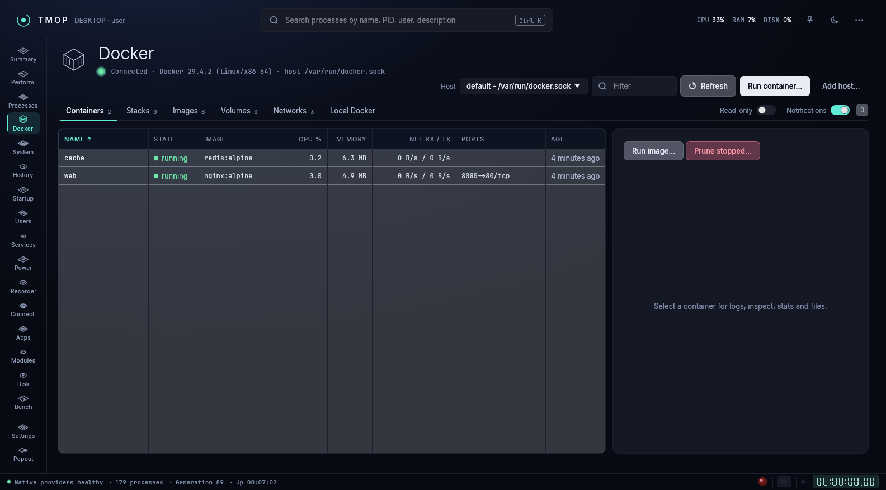 | 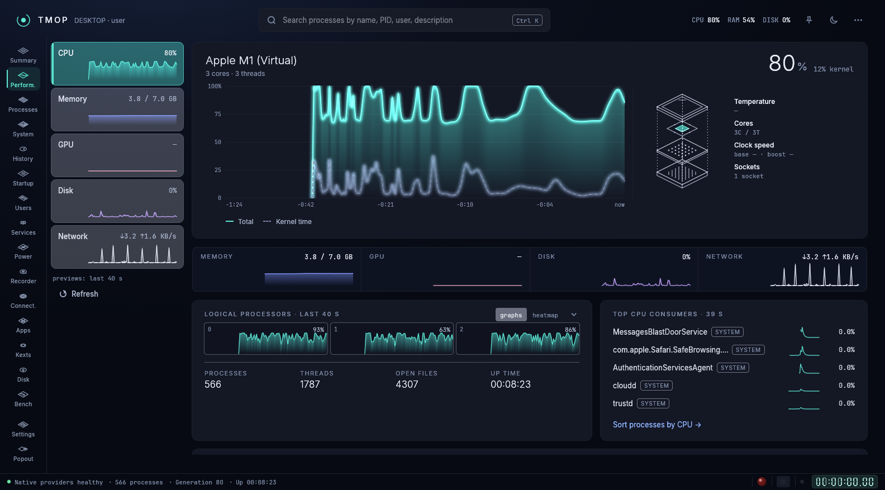 |

| | Windows | Linux | macOS |
|---|---|---|---|
| Summary and Performance (CPU, memory, disk, network) | ✔ | ✔ (*Swap* instead of *Page file*) | ✔ (*Swap*; no committed memory) |
| Disks separately or grouped (right-click the Disk card) | ✔ | ✔ | ✔ |
| Disk used / total storage, disk firmware revision (*Performance*) | ✔ | ✔ | — |
| Memory speed (*Performance → Memory*, *System Info*) | ✔ | Only where normal users may read the DMI table (most systems: root only) | — |
| Graphics card | ✔ with engines (3D, copy, video …) | AMD and NVIDIA (with NVIDIA's own driver), with engines where the driver reports them; Intel (i915 from Linux 5.19, xe from 6.11) with engines, counted from the programs TMOP may read (without root your own, where the desktop, browsers and games run; as root all of them) | Usage and memory, no engines |
| Clock speeds | ✔ | ✔ | Intel Macs; none on Apple Silicon |
| Temperatures (*Thermals*) | ✔ | ✔ | — |
| GPU temperature (*Performance → GPU*, *Thermals*) | GPU temperature where the graphics driver reports one to Windows (WDDM 2.4 or newer, the figure Task Manager shows) (on a laptop, not while the card is idle and drives no display); NVIDIA also through NVML while the GPU detail is open; hot spot and memory (junction) temperatures only from HWiNFO with *Shared Memory Support* on | AMD (amdgpu: GPU, hot spot, memory), Intel (xe: GPU package and memory; i915: GPU package, on cards that report it), NVIDIA (NVML: GPU) | — |
| Power & Freq | ✔ power plans | Battery, governor, power profile | Battery and power settings |
| Processes: end task, end tree, suspend, priority | ✔ | ✔ (raising priority needs root; no *Realtime*) | ✔ (no *Realtime*) |
| Processes: *Tree view* (parent and child processes) | ✔ | ✔ | ✔ |
| Processes: *Run new task* | ✔ opens programs, documents and addresses like the Run dialog | ✔ programs, started without a shell | ✔ programs, started without a shell |
| Processes: Network column (bytes per second per process) | ✔ as administrator | — | — |
| Processes: GPU column | ✔ | Intel (i915, xe) and AMD (amdgpu, Linux 5.19 or newer), for the programs TMOP may read (without root your own); not NVIDIA | — |
| Processes: *Set affinity…* (which processors a program may use) | ✔ (hidden with more than one processor group) | ✔ (all threads; others' processes need root) | — (no supported API) |
| Processes: *Search online*, *Go to services* | ✔ | ✔ | ✔ |
| Processes: *Properties*, *Create dump file* | ✔ | — | — |
| Processes: *Send signal* (one chosen signal) | — | ✔ | ✔ |
| Processes: efficiency mode | ✔ | ✔ as idle scheduling | ✔ as *Background priority* |
| Processes: other users' processes | ✔ as administrator | End or renice asks for your password (pkexec) | Some details need root |
| Users, App history, System info, Benchmarks, Flight recorder | ✔ | ✔ | ✔ |
| Startup apps: list | ✔ | Autostart entries and user services | Launch agents and daemons (no Login Items) |
| Startup apps: *Enable* / *Disable* (the system's own switch; nothing is deleted) | ✔ (all-users entries need administrator) | Autostart entries, with `Hidden=true` (not systemd units) | With `launchctl` (daemons need root; applies from the next login) |
| Services | ✔ | systemd units | launchd jobs |
| Services: *Start* / *Stop* / *Restart* | ✔ (needs administrator; Stop only where the service accepts it; running dependents stop too) | `systemctl start/stop/restart` (needs root) | `launchctl kickstart` / `kill SIGTERM` / `kickstart -k` on loaded jobs with a job file (daemons need root; no Stop for KeepAlive jobs) |
| Drivers | ✔ | as *Kernel modules* | as *Kernel extensions* |
| Installed apps | ✔ | Packages (dpkg, rpm, pacman, Flatpak, Snap) | .app bundles and Homebrew |
| Connections | ✔ | ✔ (owners of other users' sockets need root) | ✔ (your own processes) |
| Disk Space: scan and treemap | ✔ (fast MFT scan as administrator) | ✔ | ✔ (grant *Full Disk Access* for everything) |
| Disk Space: delete and Clean up | ✔ Recycle Bin | ✔ Trash | ✔ Trash |
| Docker: containers, logs, terminal, files, stacks | ✔ | ✔ | ✔ |
| Docker: TMOP's own engine | ✔ (WSL 2) | — (*Local Docker* status instead) | — (*Local Docker* status instead) |
| Popout always on top, header pin | ✔ | X11 only (not on Wayland) | ✔ |
| Skins, palettes, fonts, system light/dark theme | ✔ | ✔ | ✔ |
| Open TMOP instead of Task Manager | ✔ | — | — |
| Keep running in the notification area, shortcut, start with Windows | ✔ | — | — |
| Low-power mode (switch in *Settings → General*) | ✔ | ✔ | ✔ |
| Low-power mode on battery | ✔ (where a battery is readable) | ✔ (where a battery is readable) | ✔ (where a battery is readable) |
| Screensaver | ✔ (only in a build you make yourself, with `--features screensaver`) | — | — |

### Where TMOP keeps its files

| | Windows | Linux | macOS |
|---|---|---|---|
| Settings and palettes | `%LOCALAPPDATA%\TMOP` | `~/.config/tmop` (`$XDG_CONFIG_HOME`) | `~/Library/Application Support/TMOP` |
| Recordings, benchmarks, logs | `%LOCALAPPDATA%\TMOP` | `~/.local/share/tmop` (`$XDG_DATA_HOME`) | `~/Library/Application Support/TMOP` |
| Your skins | `%LOCALAPPDATA%\TMOP\Skins` | `~/.local/share/tmop/skins` | `~/Library/Application Support/TMOP/Skins` |
| Installed by the install command | `%LOCALAPPDATA%\Programs\TMOP` | `~/.local/bin/tmop`, `~/.local/share/applications/tmop.desktop`, icons in `~/.local/share/icons/hicolor` | `~/Applications/TMOP.app` |

## Open TMOP instead of Windows Task Manager

*Windows only.* In *Settings*, under *Task Manager*, turn on **Open TMOP instead of Windows Task
Manager**. From then on, Ctrl+Shift+Esc, *Task Manager* in the taskbar menu and `taskmgr` all
open TMOP. Windows asks for administrator permission, and the change applies to every user of
the PC.

- Pressing Ctrl+Shift+Esc again brings the open TMOP window to the front instead of opening a
  second one.
- You can still reach the real Task Manager: *File* → *Open Windows Task Manager*.
- Windows remembers where TMOP.exe is. **Before you move or delete TMOP.exe, turn the setting
  off**; otherwise Ctrl+Shift+Esc opens nothing. If you start a moved copy, TMOP offers to fix it.
- Don't set TMOP.exe to *Run this program as an administrator* (Properties → Compatibility).
  Windows can't start such a program from Ctrl+Shift+Esc or the taskbar: Ctrl+Shift+Esc does
  nothing and the taskbar shows *The requested operation requires elevation*. Turning the
  setting on removes that checkbox, and TMOP offers to remove it if it is set later. To run TMOP
  as administrator once, right-click it and choose *Run as administrator*.
- To turn it off without the window, run `TMOP.exe --restore-taskmgr`.
- If TMOP.exe is already gone, open *Command Prompt* as administrator and run:

  ```
  reg delete "HKLM\SOFTWARE\Microsoft\Windows NT\CurrentVersion\Image File Execution Options\taskmgr.exe" /v Debugger /f
  ```

## Command line

- `tmop --version` (or `-V`) prints the version, `tmop --help` (or `-h`) lists the options. Both
  print to the terminal and exit without opening a window. An unknown option starting with `--`
  is reported the same way and ends with exit code 2.
- `tmop --dump` prints two samples of CPU, memory, disk, network, GPU and the biggest processes
  and exits. On Windows it prints into the console it was started from.
- `tmop --page=<id>`, `--screenshot=<file.png>` and the other options are in `tmop --help`.
- On Linux, TMOP without an X11 or Wayland session (no `DISPLAY` or `WAYLAND_DISPLAY`, for
  example over plain SSH) says so in one line and exits with code 1.

## Keep TMOP in the notification area

*Windows only.* This needs no administrator rights and no registry change outside your own user.
In *Settings*, under *Notification area*:

- **Keep TMOP running in the notification area**: closing or minimizing the window hides it
  next to the clock instead of ending TMOP. Click the icon to show or hide the window; its
  right-click menu has *Open TMOP* and *Exit*. Starting TMOP again (on its own, or with only
  `--page=`) brings the running one to the front; a start with other options (`--record`,
  `--bench=`, `--disk-root=`, ...) opens a separate window that ends when you close it. An
  elevated start (*Run as administrator*) takes the place of a TMOP that is not elevated.
  While the window is hidden, TMOP samples every 5 seconds (at your speed while the flight
  recorder writes a recording), so the flight recorder keeps a record of that time. The CPU,
  memory and temperature alerts keep watching (one may come up to 5 seconds later than with
  the window open, never earlier), and Docker container alerts still arrive as notifications.
- **Shortcut to open TMOP**: click the field and press a combination with Ctrl, Alt or the
  Windows key, such as Ctrl + Alt + T. TMOP registers it with Windows (`RegisterHotKey`; there
  is no keyboard hook). If another program or Windows already uses it, TMOP says so and the
  shortcut stays off.
- **Start with Windows**: starts TMOP hidden in the notification area when you sign in (a
  `TMOP` entry under `HKCU\Software\Microsoft\Windows\CurrentVersion\Run`). If you move
  TMOP.exe, Settings shows that the entry points at the old place.
- `TMOP.exe --exit` ends a TMOP that runs in the notification area. `TMOP.exe --tray` (or
  `--hidden`) starts it hidden there.

## Low-power mode

Low-power mode makes TMOP use less CPU and GPU. It is on Windows, Linux and macOS. In *Settings →
General*, turn on **Low-power mode** (off by default). While it is on:

- Graphs have no glide, no glow and no gradient fill under the line. They step with each sample.
- TMOP samples at most once a second. If you chose a slower speed, that stays.
- While the window is in the background, TMOP redraws less often. Each new sample still brings a
  redraw.
- A **Low power** chip appears at the left of the status bar. Hover it to see why the mode is on;
  click it to open *Settings → General*.

**Turn on automatically on battery** (off by default) switches the mode on while the computer
runs on its battery, and off again on mains power. The row appears only on a computer where TMOP
can read a battery.

What stays the same: your own settings are not changed, so turning the mode off gives back
exactly what you had. Readings are as exact as before, and the alerts keep working. A running
flight recorder recording keeps its full rate. A paused TMOP stays paused. While TMOP is hidden
in the notification area, it samples every 5 seconds, as before.

On one Windows desktop (no battery), TMOP's own CPU use fell from roughly 5-9 % of one core to
about 1 %. These are rough figures from two 30-second runs per page, not a promise for your
computer. The battery option has been tested by unit tests only, not on a real laptop.

Known limit: right after the mode switches on or off, the "last N s" labels on the graphs can be
off for a while (by up to a factor of two).

Separately, and without a setting, pages that show no moving graph redraw only when something
changes.

## Update or remove

TMOP can tell you about new versions: turn on *Check for updates when TMOP starts* in
*Settings → General*. It then asks GitHub at most once a day when it starts, and shows what's new
when there is a newer version. On Windows, *Update now* downloads it, checks it and restarts TMOP;
on Linux and macOS TMOP shows the command that updates it. Your settings are kept when you update.

**Using a fork of TMOP?** Its releases take updates from the fork: the release workflow builds
them with `TMOP_RELEASE_REPO` set to the fork's repository. To follow a fork from another
copy, enter its GitHub repository (`owner/name`) under *Settings → General → Update source*.
Only enter a fork you trust, since TMOP installs what it publishes. A fork that keeps the
release workflow publishes the same files, which the update needs (on Linux and macOS the
command also expects the fork's GitHub Pages site with `install.sh`).

- **Installed with a command?** Run the same command again to update.
  - Windows: remove TMOP in *Settings → Apps → Installed apps* (that also hands Ctrl+Shift+Esc
    back to Task Manager).
  - Linux and macOS: remove it with
    `curl -fsSL https://tekikaito.github.io/tmop/install.sh | sh -s -- --uninstall`.
    It removes exactly the files it installed.
- **Installed with Scoop (Windows)?** Update with `scoop update tmop`: TMOP does not replace
  its own exe there, its update dialog shows that command (with a Copy command button). Remove with
  `scoop uninstall tmop`.
- **Installed from a `.deb` or `.rpm`, or with Nix (Linux)?** TMOP does not replace its own files
  there: its update dialog shows how to update (download the new package from the release page;
  `nix flake update tmop`).
- **Installed with Homebrew (macOS)?** Update with `brew upgrade --cask tmop` (or just
  `brew upgrade`), remove with `brew uninstall --cask tmop`; add `--zap` to also remove your
  settings.
- **Downloaded by hand?** Download the newest version and replace the old file (TMOP.exe, the
  AppImage, or TMOP in *Applications*). On Windows, keep the new TMOP.exe in the same place if
  TMOP opens instead of Task Manager. To remove TMOP, delete that file; on Windows, if TMOP opens
  instead of Task Manager, turn that off first (see above).
- **To also remove your settings**, delete the folders listed under
  [Where TMOP keeps its files](#where-tmop-keeps-its-files).

## Good to know

- The Docker page appears when Docker is installed; you can hide it in *Settings*. On Windows without Docker, *Settings → Other options → Show the Docker page* lists it to set up TMOP's own engine.
- **Docker on another computer:** on the Docker page click *Add host…*, choose *SSH* and enter
  `user@server` (or pick a host you already added with `docker context create`). TMOP never asks
  for or stores a password: it starts your system's `ssh` (OpenSSH, built into Windows 10 and 11),
  which signs in with your SSH key. Set that up once in a terminal, then add the host in TMOP:

  ```sh
  ssh-keygen -t ed25519            # only if you have no key yet
  ssh-copy-id user@server          # Windows: type $env:USERPROFILE\.ssh\id_ed25519.pub | ssh user@server "cat >> ~/.ssh/authorized_keys"
  ssh user@server docker version   # must work without a password prompt
  ```

  A key with a passphrase works when it is loaded in `ssh-agent`. A different key file, user or
  port goes in `~/.ssh/config` under a `Host` entry, whose name you then enter as the host. The
  user on the server needs access to Docker (for example by being in the `docker` group).
- **Container terminals:** a shell opened on a container's *Terminal* tab has `TMOP_SESSION` set to a random value; closing the tab (or TMOP) sends SIGHUP to the processes that carry it, like closing a terminal window, so nothing you leave running there outlives the tab unless it ignores SIGHUP (for example under `nohup`).
- **CPU temperature on Windows:** Windows itself only reports the firmware's ACPI zones. For the
  CPU's own sensor (AMD Ryzen Tctl/Tdie or the Intel package), install the free
  [PawnIO](https://pawnio.eu) driver (x64 PCs only), switch on *Settings → General → CPU temperature through
  PawnIO* and run TMOP as administrator. It is off by default. Some anti-cheat software refuses
  to run beside PawnIO. TMOP also reads HWiNFO's sensors when *Shared Memory Support* is on there.
  The PawnIO modules TMOP carries are LGPL-2.1-or-later (licence and source in `assets/pawnio`).
- **GPU temperature on Windows:** TMOP shows the temperature the graphics driver reports to
  Windows, without administrator rights. On a laptop (a PC with a battery) a graphics card that
  is idle and drives no display is not asked, so it can power down; it shows its last reading for
  30 s, then none. Hot spot and memory junction temperatures are not part
  of that report; TMOP shows them when HWiNFO runs with *Shared Memory Support* on.
- Otherwise, run TMOP as your normal user. On Linux and macOS some details (other users' processes, socket
  owners, protected folders, on Linux the Intel graphics usage of other users' programs) need root or, on macOS, *Full Disk Access*; TMOP says so where it
  matters. After updating TMOP on macOS, remove it from *Full Disk Access* and add it again:
  macOS ties the permission to the exact build, so the switch can stay on but no longer apply.
- TMOP is an independent project. It is inspired by *Task Manager TMOG* but is not connected to
  TMOG or its makers.
- Free and open source under the [GPL-3.0](LICENSE) license. To build it yourself, install
  [Rust](https://rustup.rs) and run `cargo build --release`.
- If TMOP is useful to you, a [star on GitHub](https://github.com/tekikaito/tmop) helps others find it.
