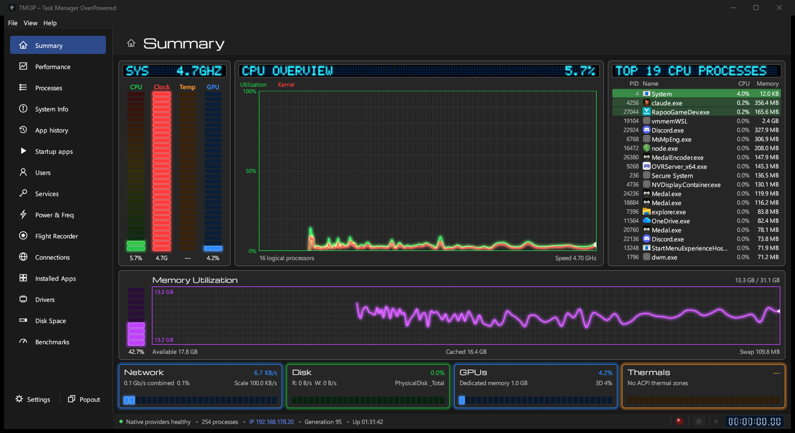
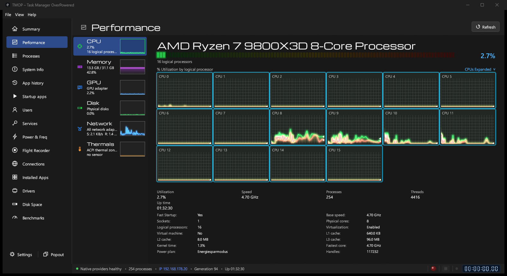
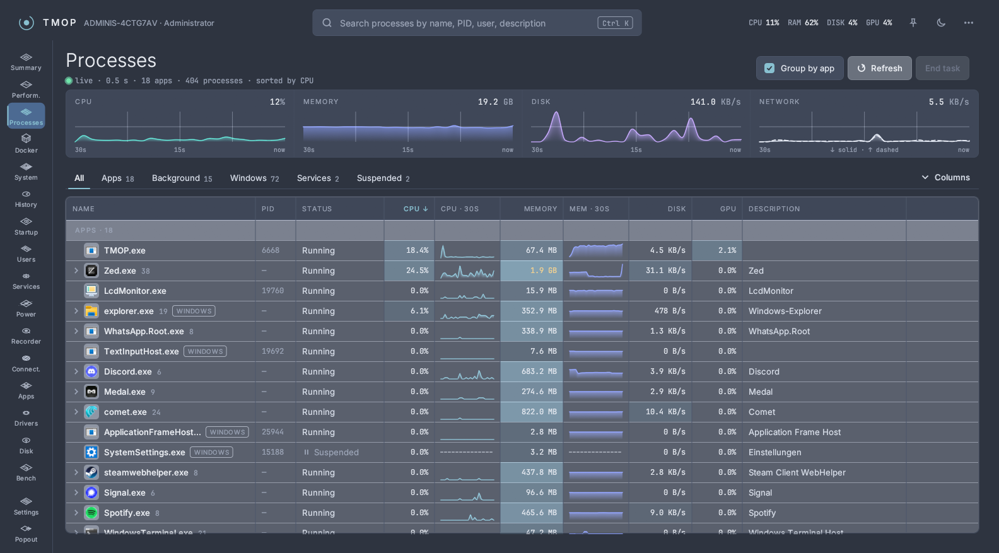
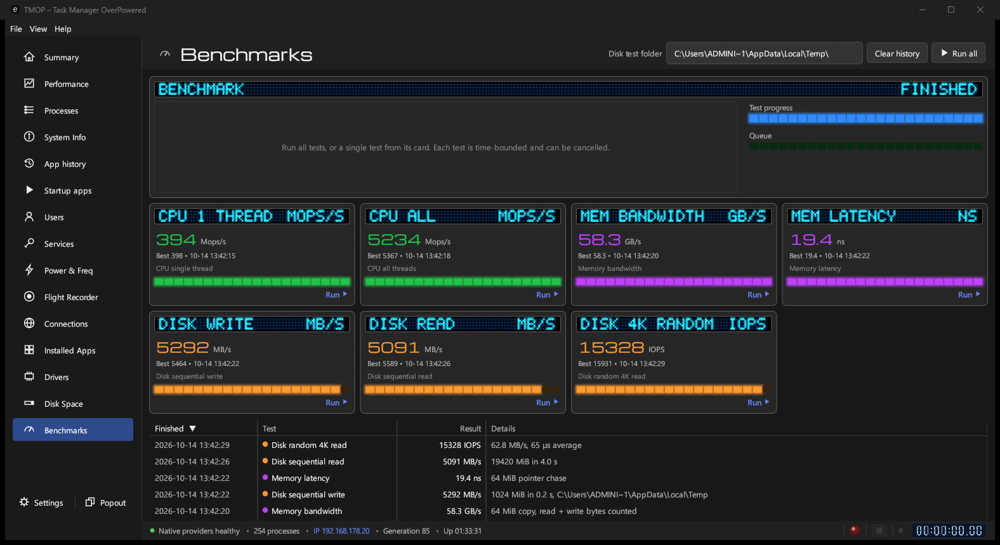
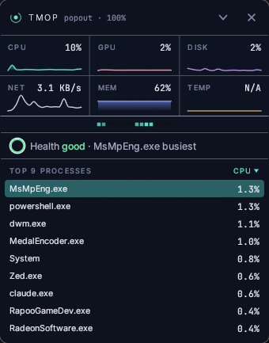

# TMOP — Task Manager OverPowered

TMOP shows what your Windows PC is doing: how busy the processor, memory, disk, network and
graphics card are, which programs are running, and much more. It is free and needs no installation.
TMOP itself sends no data. Its only internet requests go to GitHub: downloading TMOP's own Docker engine when
you set it up, and checking for a newer engine release (switch the check off on the Docker page's
*Engine* tab). A Docker engine downloads only what you ask it to (for example an image you pull).



## Get TMOP

**[Download TMOP](https://tekikaito.github.io/tmop/)**: the page picks the right version for
your PC. Or install it with one command in PowerShell. That adds TMOP to the Start menu, keeps
it up to date when you run the command again, and lets you remove it in *Settings → Apps*:

```powershell
irm https://tekikaito.github.io/tmop/install.ps1 | iex
```

To download it by hand instead:

1. Open the **[release page](https://github.com/tekikaito/tmop/releases/latest)**.
2. Under **Assets**, click **`TMOP-…-windows-x64.zip`**.
   (Only if your PC has an ARM processor, for example a Snapdragon laptop, take
   `TMOP-…-windows-arm64.zip` instead. Not sure? Choose x64.)
3. Open the downloaded zip file and drag **TMOP.exe** to a place you like, such as your desktop.
4. Double-click **TMOP.exe**.

That's it. There is no installer.

**Windows shows a blue "Windows protected your PC" window?** That happens with new programs
that Windows doesn't know yet. Click **More info**, then **Run anyway**. You only have to do this
once.

## What you can do with it

| See your PC's performance live | Find and close programs |
|---|---|
|  |  |
| **Test how fast your PC is** | **Keep a small monitor on your desktop** |
|  |  |

- **Close a program that hangs:** go to *Processes*, right-click it and choose *End task*.
- **Find out what fills your disk:** go to *Disk Space* and start a scan.
- **See which programs start with Windows, which apps are installed** and a lot more in the menu
  on the left.
- **Open the small desktop monitor** with the *Popout* button at the bottom left.
- **Manage your Docker containers:** a *Docker* page shows your containers, images and volumes, with logs, stats and files; you can start, stop and remove them. It works with Docker Desktop or with TMOP's own engine, which you set up on the page's *Engine* tab (on Windows it needs WSL 2).

## Open TMOP instead of Windows Task Manager

In *Settings*, under *Task Manager*, turn on **Open TMOP instead of Windows Task Manager**.
From then on, Ctrl+Shift+Esc, *Task Manager* in the taskbar menu and `taskmgr` all open TMOP.
Windows asks for administrator permission, and the change applies to every user of the PC.

- Pressing Ctrl+Shift+Esc again brings the open TMOP window to the front instead of opening a
  second one.
- You can still reach the real Task Manager: *File* → *Open Windows Task Manager*.
- Windows remembers where TMOP.exe is. **Before you move or delete TMOP.exe, turn the setting
  off**; otherwise Ctrl+Shift+Esc opens nothing. If you start a moved copy, TMOP offers to fix it.
- To turn it off without the window, run `TMOP.exe --restore-taskmgr`.
- If TMOP.exe is already gone, open *Command Prompt* as administrator and run:

  ```
  reg delete "HKLM\SOFTWARE\Microsoft\Windows NT\CurrentVersion\Image File Execution Options\taskmgr.exe" /v Debugger /f
  ```

## Update or remove

- **Installed with the PowerShell command?** Run the command again to update; remove TMOP in
  *Settings → Apps → Installed apps* (that also hands Ctrl+Shift+Esc back to Task Manager).
- **Update:** download the newest version as above and replace your old TMOP.exe with it.
  Your settings are kept. Keep the new TMOP.exe in the same place if TMOP opens instead of
  Task Manager.
- **Remove:** if TMOP opens instead of Task Manager, turn that off first (see above). Then delete
  TMOP.exe. To also remove its settings, delete the folder `%LOCALAPPDATA%\TMOP` (paste that into
  the address bar of File Explorer).

## Good to know

- TMOP runs on Windows 10 and 11. Versions for Linux and Mac are planned.
- The Docker page appears when Docker is installed or TMOP's own engine can run on this PC; you can hide it in *Settings*.
- TMOP is an independent project. It is inspired by *Task Manager TMOG* but is not connected to
  TMOG or its makers.
- Free and open source under the [GPL-3.0](LICENSE) license. To build it yourself, install
  [Rust](https://rustup.rs) and run `cargo build --release`.
